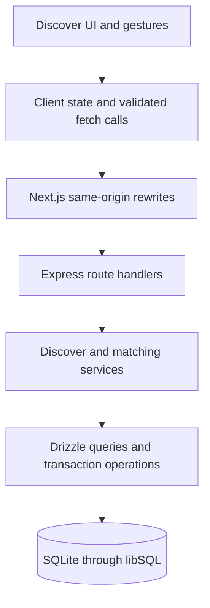

# Coy Discover

 Users can browse profiles, like or pass with gestures or buttons, and view mutual matches. Express controls matching and privacy; SQLite stores progress across reloads and server restarts.

## Demo

**[Watch the screen recording](assets/coy-discover-demo.mov)**


## Features

- One profile at a time, with name, age, photo, bio, city or college, and interests.
- Right swipe to like, left swipe to pass, plus keyboard-accessible Like/Pass buttons. Short or predominantly vertical drags cancel.
- Immediate match dialog for a newly committed mutual like, with a Matches view inside Discover.
- Full-height layout with a centered mobile-width column on desktop. Profile content, actions, and Home/Discover navigation remain within that column.
- Loading, saving, error/retry, empty-feed, and empty-Matches states; image fallbacks, visible focus, modal focus handling, and reduced-motion support.
- Persistent swipes and matches, safe retries, and protection against duplicate or conflicting decisions.

Home intentionally has blank content. The application uses one server-defined demo user and has no authentication.

## Tech stack

| Area               | Technology                                                                |
| ------------------ | ------------------------------------------------------------------------- |
| Frontend           | Next.js App Router, React, strict TypeScript                              |
| Styling and motion | Tailwind CSS, Motion for React                                            |
| Backend            | Node.js, Express 5, strict TypeScript                                     |
| Database           | SQLite through libSQL, Drizzle ORM, versioned SQL migrations              |
| Validation         | Zod for configuration, seed data, API input/output, and browser responses |
| Testing            | Vitest unit and integration tests                                         |
| Code quality       | ESLint, Prettier                                                          |
| Package management | pnpm workspaces with a committed lockfile                                 |

## Run locally

### Prerequisites

Use **Node.js 24.22.3** and **pnpm 11.28.12**. The runtime is recorded in `.nvmrc` and `.node-version`; the package manager is pinned in `package.json`. The workspace enforces its Node and pnpm versions.

If pnpm is not installed, run this after selecting Node 24:

```sh
npm install --global pnpm@11.28.12
```

If you use nvm, `nvm install` followed by `nvm use` from the project root selects the recorded Node version.

### Install and start

```sh
git clone https://github.com/AdityaKumbhar21/coy-discover.git
cd coy-discover
pnpm install --frozen-lockfile
pnpm db:migrate
pnpm db:seed
pnpm dev
```

For an existing checkout, start at `pnpm install --frozen-lockfile` in its root directory.

Open **[http://localhost:3000](http://localhost:3000)**. The command starts both applications:

| Application      | Local address           |
| ---------------- | ----------------------- |
| Next.js frontend | `http://localhost:3000` |
| Express backend  | `http://127.0.0.1:4000` |

No `.env` file or external account is required. The database is created at `backend/coy.sqlite`. Seeding again preserves existing swipes, matches, and profile data. Stop the servers with **Ctrl+C**.

To run each application separately, use `pnpm dev:frontend` and `pnpm dev:backend` in separate terminals.

### Production build

```sh
pnpm build
pnpm start:backend
```

In another terminal at the project root:

```sh
pnpm start:frontend
```

Apply migrations and seed data before starting a fresh database. A successful local production build does not imply that hosting or durable deployment storage has been configured.

## Architecture

The repository contains two applications in one pnpm workspace. Next.js owns presentation and browser interactions; Express owns HTTP validation and business rules. All persistence and synthetic seed relationships remain in the backend.



The browser calls exactly `/feed`, `/swipe`, and `/matches` on the frontend origin. Next.js rewrites those paths to Express. There is no second set of Next.js API handlers and no `/api` prefix. The browser does not need the backend address or database credentials.

### Responsibilities

| Layer                      | Location                                   | Responsibility                                                                           |
| -------------------------- | ------------------------------------------ | ---------------------------------------------------------------------------------------- |
| Page composition           | `frontend/src/app/`                        | Compose Discover, blank Home, and the Matches subview                                    |
| Presentational components  | `frontend/src/components/discover/`        | Cards, gestures, action buttons, navigation, states, and the match dialog                |
| Client controller          | `frontend/src/hooks/useDiscover.ts`        | Fetch lifecycle, submission lock, retry, and refresh orchestration                       |
| Client state and contracts | `frontend/src/lib/`                        | Strict response validation, safe errors, stale-response handling, and gesture thresholds |
| HTTP transport             | `backend/src/routes/`, `backend/src/http/` | Validate requests, invoke services, serialize responses, and handle errors               |
| Business logic             | `backend/src/services/`                    | Fixed actor identity, immutable swipe behavior, and reciprocal matching                  |
| Persistence                | `backend/src/db/`                          | Drizzle schema/queries, connection ownership, atomic writes, and contention retries      |
| Database lifecycle         | `backend/drizzle/`, `backend/scripts/`     | Reviewed migrations and deterministic seed data                                          |
| Verification               | `tests/unit/`, `tests/integration/`        | Focused unit tests and real-database/HTTP integration tests                              |

Route handlers stay thin. Services implement matching rules; database modules implement storage operations. The frontend never imports backend modules, and ESLint enforces that boundary. Components receive public profile/match data rather than database rows.

## Data model and persistence

| Table      | Stores                                                      | Important constraints                                                                      |
| ---------- | ----------------------------------------------------------- | ------------------------------------------------------------------------------------------ |
| `profiles` | Public profile fields; interests stored as JSON             | Primary key, valid adult age, nonempty fields and interests                                |
| `swipes`   | Directed actor-to-target like/pass decisions and timestamps | Composite primary key `(actor_id, target_id)`, foreign keys, valid decision, no self-swipe |
| `matches`  | Mutual profile pairs and creation timestamps                | Unique canonical pair, foreign keys, `profile_low_id < profile_high_id`                    |

Canonical ordering stores either direction of a pair as the same match. Reciprocal likes are verified by the service; database constraints prevent duplicate directed swipes and duplicate match pairs.

The seed inserts **30 synthetic adult candidates**, a separate demo user, and three incoming likes. It creates no outgoing demo swipes or initial matches. All photos use a bundled local placeholder. Seed validation runs before an atomic write, and repeated seeding does not reset progress.

### Atomic matching and concurrency

For a swipe, the service:

1. Opens a write transaction and validates the configured actor and target.
2. Checks any existing decision. An identical retry returns the saved result; a different decision returns `409`.
3. Records a new decision and checks the reverse swipe. Only two likes create a canonical match.
4. Validates the public response inside the transaction, so validation failures also roll back writes.
5. Returns success only after the swipe and any match commit together.

The local driver uses `BEGIN IMMEDIATE` write transactions. Each connection enables and verifies foreign keys. Database lock contention retries the whole operation with a fresh connection, up to three attempts; exhausted contention returns a safe `503`. Independent-connection integration tests cover simultaneous requests and rollback.

Use `pnpm db:migrate` to apply checked-in migrations. Generate future schema changes with `pnpm db:generate` and review the SQL before applying it.

## Matching and privacy rules

- The server chooses the demo actor. Requests contain only the target profile and decision; caller-supplied actor fields are rejected.
- Incoming likes are never returned as flags, counts, rankings, or relationship metadata. Feed order is stable by profile ID and independent of incoming likes.
- Only reciprocal likes produce a match. Passes and one-sided likes never reveal incoming interest.
- Every saved like or pass permanently excludes that target from future feed reads. There is no undo or decision editing.
- Public responses use allowlisted fields and strict Zod contracts. The frontend validates them again before rendering.
- Only a committed response with `matchCreated: true` opens the celebration. Identical retries do not create another match or replay the celebration.
- Feed and Matches requests bypass caching. Decisions and matches are persisted in SQLite, not browser storage.

The UI keeps a card until its save is confirmed. Pending submissions block overlapping input. A recoverable failure offers **Try again** for the original decision, and stale fetch results cannot reintroduce locally confirmed swipes. Matching decisions are never computed in the browser.

## API

All endpoints use the server-defined demo user and return JSON with `Cache-Control: no-store`. They are available through port 3000's proxy and directly on Express at port 4000. Unexpected query or body fields are rejected.

| Endpoint       | Input                                                   | Success response                                                                                                      |
| -------------- | ------------------------------------------------------- | --------------------------------------------------------------------------------------------------------------------- |
| `GET /feed`    | No query parameters                                     | `{ "profiles": Profile[] }` — unswiped candidates in stable ID order                                                  |
| `POST /swipe`  | `{ "profileId": number, "decision": "like" \| "pass" }` | `{ "swipe": { "profileId": number, "decision": "like" \| "pass" }, "matchCreated": boolean, "match": Match \| null }` |
| `GET /matches` | No query parameters                                     | `{ "matches": Match[] }` — mutual matches, newest first                                                               |

Public records have these fields:

```ts
type Profile = {
  id: number;
  name: string;
  age: number;
  photoUrl: string;
  bio: string;
  cityOrCollege: string;
  interests: string[];
};

type Match = {
  id: number;
  profile: Profile; // The other profile in the mutual match.
  createdAt: string; // UTC ISO 8601 timestamp.
};
```

`matchCreated: true` always includes a match. A one-sided like or pass returns `false` with `match: null`. An identical like retry may include the existing mutual match, with `matchCreated: false`. Empty feeds and empty Matches lists return `200` with an empty array.

Example requests:

```sh
curl http://localhost:3000/feed

# Records a real decision in the selected demo database.
curl -X POST http://localhost:3000/swipe \
  -H 'Content-Type: application/json' \
  -d '{"profileId":1001,"decision":"like"}'

curl http://localhost:3000/matches
```

Errors use `{ "error": { "code": "...", "message": "..." } }`. Responses use fixed messages without database details, request contents, or stack traces.

| Status | Meaning                                              |
| ------ | ---------------------------------------------------- |
| `400`  | Invalid input or a self-swipe                        |
| `404`  | Unknown profile or route                             |
| `405`  | Unsupported method; includes an `Allow` header       |
| `409`  | A different decision is already saved                |
| `413`  | JSON body exceeds the 4 KiB limit                    |
| `415`  | Unsupported content type                             |
| `503`  | Database unavailable or contention retries exhausted |
| `500`  | Unexpected internal failure                          |

## Configuration

Defaults work without an environment file. Backend configuration and the Next.js proxy destination are validated with Zod.

| Variable         | Default                 | Purpose                                                                                                                          |
| ---------------- | ----------------------- | -------------------------------------------------------------------------------------------------------------------------------- |
| `BACKEND_HOST`   | `127.0.0.1`             | Express listen address; `0.0.0.0` is also accepted                                                                               |
| `BACKEND_PORT`   | `4000`                  | Express port                                                                                                                     |
| `DATABASE_URL`   | `file:./coy.sqlite`     | Persistent local file; relative paths resolve from `backend/`, and the parent directory must exist                               |
| `BACKEND_ORIGIN` | `http://127.0.0.1:4000` | Next.js proxy destination, set before frontend dev/build; use an HTTP(S) origin without credentials, query, or path              |
| `DEMO_USER_ID`   | `1`                     | Server-controlled demo identity; keep consistent for migration/seed/runtime commands, and do not use candidate IDs `1001`–`1030` |

Only **local SQLite** is currently enabled. Remote libSQL URLs and `DATABASE_AUTH_TOKEN` are recognized by configuration validation, but the connection factory deliberately rejects remote connections until transaction guarantees are verified. Do not expose database settings through `NEXT_PUBLIC_*` variables.

### Isolated demo for a screen recording

To demonstrate from a fresh seed without changing existing development progress, stop any running app, then run these commands from the project root in one terminal:

```sh
coy_demo_dir=$(mktemp -d)
export DATABASE_URL="file:$coy_demo_dir/coy.sqlite"
pnpm db:migrate
pnpm db:seed
pnpm dev
```

The first profile in a fresh seed supports an immediate mutual-match demonstration via Like. Continue with pass/like interactions, open Matches, and reload to show persistence. This setup keeps the original `backend/coy.sqlite` untouched. The temporary directory is not automatically deleted on exit; `unset DATABASE_URL` before returning to the default database in that terminal.

## Testing and verification

Run from the repository root:

```sh
pnpm format:check
pnpm lint
pnpm typecheck
pnpm test
pnpm build
```

The most recent application verification passed **59 unit tests and 80 integration tests (139 total)**, plus formatting, lint, typecheck, and the production build.

| Suite       | Coverage                                                                                                                                                                             |
| ----------- | ------------------------------------------------------------------------------------------------------------------------------------------------------------------------------------ |
| Unit        | Configuration, matching rules/contracts, browser response validation, safe errors, stale-response handling, retry state, and gesture thresholds                                      |
| Integration | Migrations, constraints, deterministic seed behavior, feed exclusion, exact HTTP routes, reciprocal matching, privacy, atomic rollback, concurrency, and persistence after reopening |

Integration tests use isolated temporary SQLite files and ephemeral loopback HTTP servers. They clean up their databases and do not require a separately running app or modify development progress. Run suites individually with `pnpm test:unit` and `pnpm test:integration`.

Manual browser checks covered desktop and 320px/390px layouts, blank Home, profile fields, buttons, both drag directions, short/vertical drag cancellation, match-dialog focus and Escape, Matches, reload persistence, feed exhaustion, and retry after a real database write lock. The full-height column was also checked without horizontal overflow. Physical-device touch and explicit reduced-motion visual checks remain outstanding.

Playwright and automated end-to-end tests are deferred. A GitHub Actions workflow has not been added; the commands above currently run locally.

## Useful commands

| Command                                      | Purpose                                                  |
| -------------------------------------------- | -------------------------------------------------------- |
| `pnpm dev`                                   | Start both applications                                  |
| `pnpm dev:frontend` / `pnpm dev:backend`     | Start one application in development                     |
| `pnpm build`                                 | Build backend TypeScript and the Next.js frontend        |
| `pnpm start:frontend` / `pnpm start:backend` | Start a previously built application                     |
| `pnpm db:migrate`                            | Apply committed SQL migrations                           |
| `pnpm db:seed`                               | Apply deterministic seed data without resetting progress |
| `pnpm db:generate`                           | Generate a migration for an intended schema change       |
| `pnpm test:unit` / `pnpm test:integration`   | Run a test suite without watch mode                      |
| `pnpm format`                                | Format source/configuration/documentation with Prettier  |

## Troubleshooting and limitations

- **`pnpm: command not found`:** install the pinned version above. If npm's global bin directory is missing from your shell path, run `export PATH="$(npm config get prefix)/bin:$PATH"` and retry. Use pnpm for this workspace; `--frozen-lockfile` is not an npm install option.
- **Engine version error:** check `node -v` and `pnpm -v` against the prerequisites. Node 26 does not satisfy this project's Node 24 engine range.
- **Profiles fail to load:** ensure Express is running, migrations and seed completed, and `BACKEND_ORIGIN` points to its port. A port already in use must be freed or configured consistently across both apps.
- **Old layout or hydration warning after UI edits:** hard refresh with **Cmd+Shift+R** on macOS. If it persists, stop the frontend, remove only its generated `frontend/.next/dev` directory, and restart it.
- **Shared demo state:** every browser uses the same server-defined user. Decisions in one browser affect the others; this is intentionally not a multi-user authentication system.
- **Local persistence only:** SQLite survives ordinary restarts on the same disk. Remote database behavior and deployment durability have not been verified; ephemeral hosting storage would not preserve progress.
- **Lost successful response:** retrying preserves the durable swipe/match but may miss the one-time match celebration. The Matches view remains authoritative.
- **Bounded assignment scope:** placeholder photos, a small unpaginated feed, and no chat, filters, undo, payments, authentication, or reset API.

Dependency resolutions are pinned in `pnpm-lock.yaml`. Environment files, local databases and journals, dependency directories, and generated build/test artifacts are ignored by Git.
